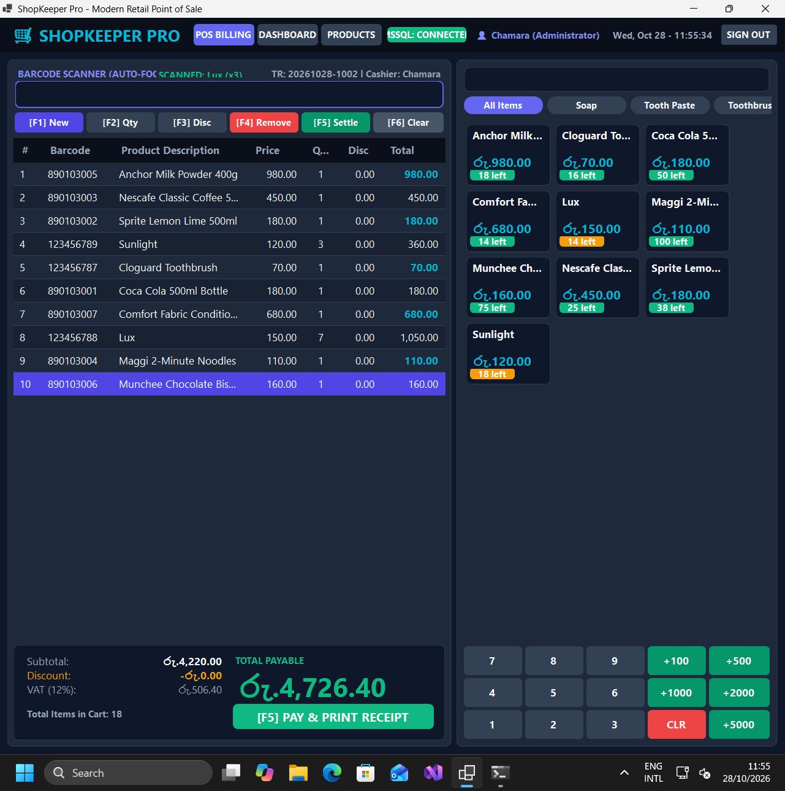
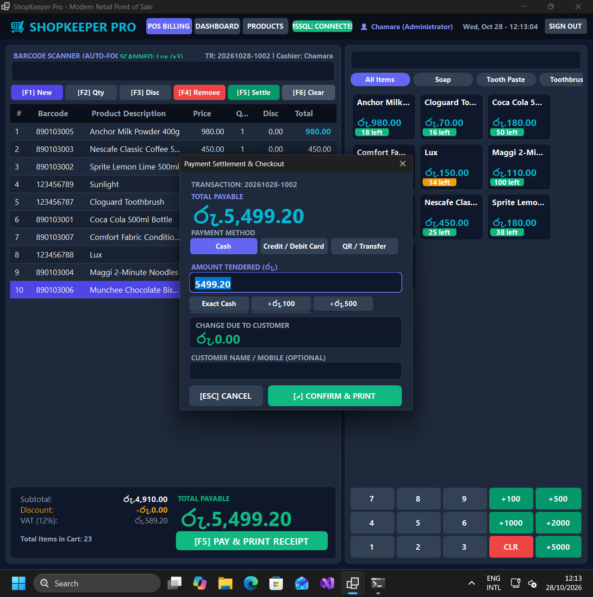
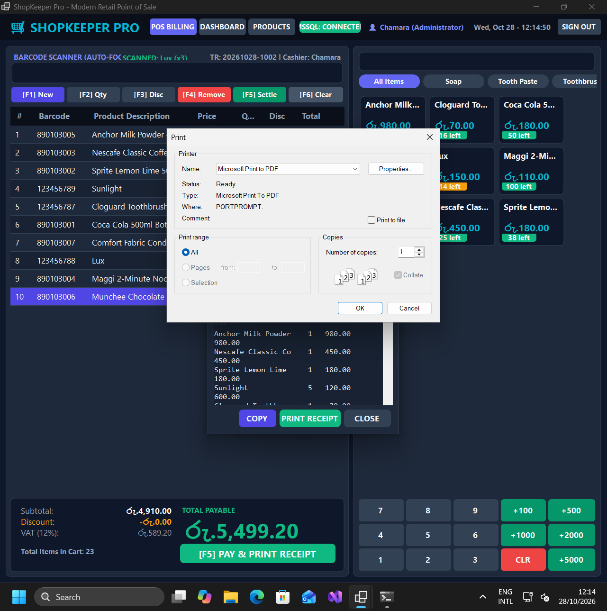
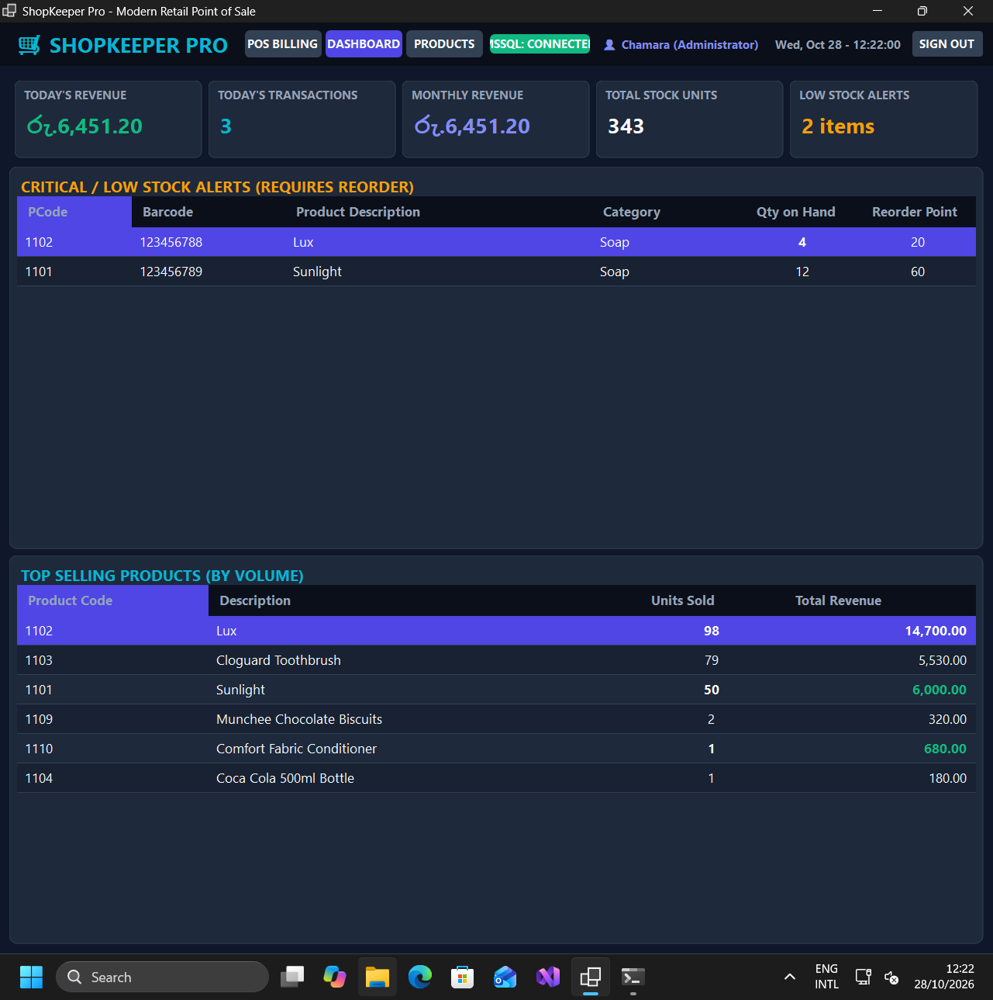
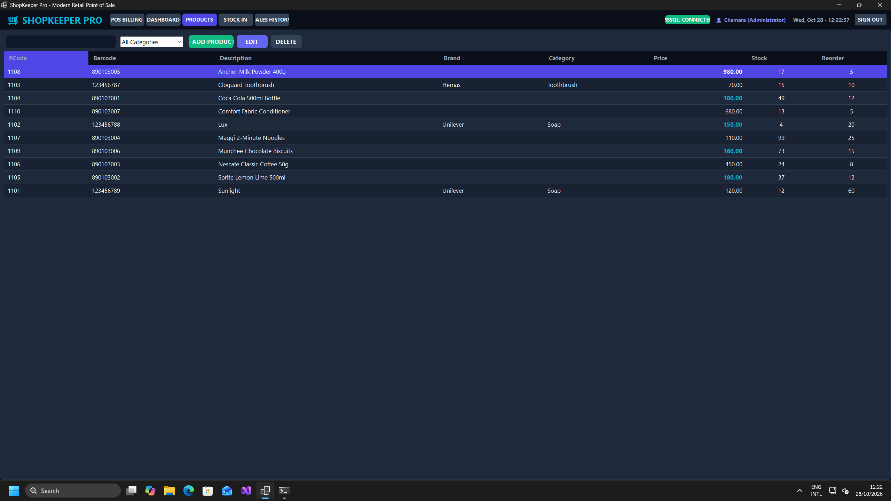

# 🛒 ShopKeeper Pro — Retail Point of Sale & Inventory Management

[](#)
[](#)
[](#)
[-059669)](#)
[](#)

**ShopKeeper Pro** is a high-performance, modern dark-themed Point of Sale (POS) and inventory management system designed for fast-paced retail stores, supermarkets, pharmacies, and specialty shops. 

Built natively with **C# and .NET 10 Windows Forms**, ShopKeeper Pro features custom hardware-accelerated **Windows 11 Desktop Window Manager (DWM) dark mode title bars**, anti-aliased rounded dialog corners, fast barcode scanning with multiplier syntax, live receipt printing, real-time stock deductions, and executive analytics.

---

## 📸 System Walkthrough & User Manual

### 1. POS Billing & High-Speed Checkout Screen
The cashier workflow is built for zero-friction operation. Cashiers can operate entirely via barcode scanner, keyboard hotkeys (`F1`–`F6`), or touch/mouse clicks on the fast-catalog product grid.



#### Cashier Functions & Keyboard Shortcuts:
| Shortcut | Action | Description |
|---|---|---|
| **`[AUTO-FOCUS]`** | **Barcode Scan** | Ready at all times. Supports direct barcode (`123456789`) and multiplier format (`3*123456788` for 3 units of Lux). |
| **`F1`** | **New Transaction** | Clears the current order and generates a new sequential Transaction Reference (`TR: YYYYMMDD-XXXX`). |
| **`F2`** | **Change Quantity** | Select any line item in the cart and press `F2` to enter a new quantity via modal or keypad. |
| **`F3`** | **Item Discount** | Apply line-level discount in Rupee (`රු.`) value. Deducts instantly from item subtotal. |
| **`F4`** | **Remove Item** | Removes the highlighted product from the active cart. |
| **`F5`** | **Settle / Pay** | Opens the Payment Settlement modal to collect payment and print the receipt. |
| **`F6`** | **Clear Cart** | Clears all line items from the cart with confirmation. |
| **`[↵]`** | **Submit Input** | Processes barcode scans and dialog confirmations throughout the interface. |

---

### 2. Payment Settlement & Tender Modal
Pressing `F5` or clicking **[F5] PAY & PRINT RECEIPT** brings up the payment dialog. It automatically applies Windows 11 immersive dark mode and native window corner rounding with zero artifact borders.



#### Settlement Features:
- **Payment Method Selection:** Toggle between **Cash**, **Credit / Debit Card**, and **QR / Bank Transfer**.
- **Quick Tender Presets:** Click **Exact Cash**, **+රු.100**, **+රු.500**, **+රු.1,000**, or **+රු.5,000** for rapid cash counting.
- **Dynamic Change Calculation:** Real-time green highlight when change is due; red `(SHORT)` warning if the customer pays less than the payable amount.
- **Optional Customer Tagging:** Enter customer name or mobile number for receipt tracking and loyalty history.
- **Action Buttons:** 
  - `[↵] CONFIRM & PRINT` — Finalizes transaction, logs payment, decrements inventory atomically, and triggers receipt.
  - `[ESC] CANCEL` — Returns back to active cart without losing any items.

---

### 3. Thermal Receipt Generation & Printing
Once payment is confirmed, ShopKeeper Pro automatically formats an industry-standard **42-column ESC/POS thermal receipt** and opens the preview & print dialog.



#### Receipt Details:
- Store header, tax identification number, contact telephone (`+94 (11) 555-0199`).
- Unique Transaction ID, date/time stamp, and cashier username.
- Itemized breakdown: product name, quantity, unit price, line discount, and line total.
- Summary block: Subtotal, Discount, VAT (12%), and Grand Total in `රු.`.
- Tendered amount, change returned, and payment method.
- Direct output to physical 58mm/80mm thermal receipt printers or **Microsoft Print to PDF**.

---

### 4. Executive Management Dashboard
The executive dashboard gives store owners and managers immediate visibility into store performance, stock health, and sales velocity.



#### Dashboard KPI Cards:
- **Today's Revenue:** Live aggregate sales revenue formatted in `රු.`.
- **Today's Transactions:** Number of completed customer orders processed today.
- **Monthly Revenue:** Month-to-date sales aggregate.
- **Total Stock Units:** Total physical units across all warehouse/store SKUs.
- **Low Stock Alerts:** Count of products whose inventory has fallen below the minimum reorder threshold.
- **Critical Reorder Table:** Color-coded list of items requiring immediate supplier purchase order.
- **Top-Selling Leaderboard:** Ranked by unit sales volume and revenue contribution.

---

### 5. Product & Inventory Catalog Management
Manage your entire SKU catalog with categorized stock tracking and wholesale margin monitoring.



#### Inventory Features:
- **Instant Search:** Filter by SKU code, barcode, or product name.
- **Category Filter:** Filter by department (Soap, Tooth Paste, Toothbrush, Beverages, Confectionery, etc.).
- **Margin Analysis:** Tracks both Cost/Wholesale Price and Retail Selling Price.
- **Stock Reorder Points:** Configurable minimum safety stock level per product.
- **Modal Editor:** Add, edit, and delete products with input validation.

---

## 🏗️ Solution Architecture

The solution is split into a modular, testable 3-tier structure:

```
ShopKeeperPro/
├── ShopKeeperPro.sln                    # Visual Studio / .NET Solution
├── docs/                                # User manual screenshots & assets
│   └── screenshots/
├── sql/
│   ├── schema.sql                       # Complete SQL Server database schema & indexes
│   └── seed.sql                         # Retail sample catalog & admin user seed data
├── src/
│   ├── ShopKeeperPro.Core/              # Business logic, repositories & domain models
│   │   ├── Data/
│   │   │   ├── DbConfig.cs              # MSSQL connection & async health checks
│   │   │   ├── ProductRepository.cs     # Catalog CRUD & stock management
│   │   │   ├── SaleRepository.cs        # Atomic checkout transaction handler
│   │   │   ├── CartRepository.cs        # Active cart session storage
│   │   │   ├── DashboardRepository.cs   # KPI & sales analytics aggregations
│   │   │   └── UserRepository.cs        # Cashier authentication
│   │   ├── Models/                      # Product, CartItem, Sale, Stock, User
│   │   └── Services/
│   │       ├── BarcodeScannerService.cs # Multiplier parser (`N*BARCODE`) & sanitizer
│   │       └── ReceiptGenerator.cs      # 42-col formatted thermal receipt builder
│   │
│   └── ShopKeeperPro.WinForms/          # Windows 11 Presentation Layer
│       ├── UI/
│       │   ├── MainForm.cs              # Main window & top navigation bar
│       │   ├── PosBillingView.cs        # POS cashier screen & catalog buttons
│       │   ├── DashboardView.cs         # Executive dashboard & alert cards
│       │   ├── ProductsView.cs          # SKU list & product modal dialog
│       │   ├── StockInView.cs           # GRN inventory receiving
│       │   ├── SalesHistoryView.cs      # Transaction history & revenue log
│       │   ├── SettleDialog.cs          # Checkout settlement & cash presets
│       │   ├── QuantityDiscountDialog.cs# Numpad quantity & discount modal
│       │   ├── ReceiptDialog.cs         # Thermal receipt preview & printer dialog
│       │   ├── UITheme.cs               # Dark slate palette & DWM Win32 interop
│       │   └── RoundedPanel.cs          # High-DPI anti-aliased custom controls
│       └── Program.cs                   # Application entry point
│
├── tests/
│   └── ShopKeeperPro.Tests/             # Automated test suite (15 verification tests)
└── scripts/                             # VM deployment & automated testing pipeline
```

---

## ⚙️ Technical Highlights

1. **Windows 11 DWM Immersive Dark Mode:**
   Uses native Win32 Desktop Window Manager interop (`dwmapi.dll`):
   ```csharp
   // Immersive Dark Titlebar & Hardware Rounded Corners
   DwmSetWindowAttribute(form.Handle, DWMWA_USE_IMMERSIVE_DARK_MODE, ref trueValue, sizeof(int));
   DwmSetWindowAttribute(form.Handle, DWMWA_WINDOW_CORNER_PREFERENCE, ref cornerRound, sizeof(int));
   ```
2. **Barcode Multiplier Syntax:**
   Supports standard scanning (`123456789`) as well as fast bulk multiplier input (`5*123456789`), eliminating repetitive scanning for bulk retail packs.
3. **Atomic Stock Decrement:**
   Checkouts execute inside SQL transactions with `READ COMMITTED` / `SERIALIZABLE` locks, ensuring inventory can never go negative even during simultaneous register checkouts.
4. **Sri Lankan Rupee Localization:**
   Configured with `රු.` currency formatting, local tax structures (12% VAT), and local telephone numbering formats.

---

## 🚀 Getting Started

### Prerequisites
- **Operating System:** Windows 10 (1809+) or **Windows 11** (ARM64 or x64)
- **SDK:** [.NET 10.0 SDK](https://dotnet.microsoft.com/download/dotnet/10.0)
- **Database:** Microsoft SQL Server (2019/2022, Developer, Express, or LocalDB)

### 1. Database Setup
Execute the SQL scripts against your SQL Server instance:

```sql
-- 1. Create database and tables
sqlcmd -S localhost -i sql/schema.sql

-- 2. Seed initial product catalog and cashier account
sqlcmd -S localhost -i sql/seed.sql
```

Default administrator credentials created by seed:
- **Username:** `chax`
- **Password:** `123`

### 2. Configure Connection String
Edit `DbConfig.cs` (or your local environment variable `SHOPKEEPER_DB_CONN`) with your SQL Server connection details:

```csharp
Server=localhost;Database=shopkeeper_db;Trusted_Connection=True;TrustServerCertificate=True;
```

### 3. Build & Run
From the solution root directory:

```bash
# Build the solution
dotnet build ShopKeeperPro.sln

# Run the automated verification tests
dotnet run --project tests/ShopKeeperPro.Tests -- --check-db

# Launch ShopKeeper Pro
dotnet run --project src/ShopKeeperPro.WinForms
```

---

## 🧪 Automated Test Suite

ShopKeeper Pro includes a comprehensive automated verification test suite:

```
==================================================
      SHOPKEEPER PRO - CORE VERIFICATION SUITE    
==================================================
[PASS] Barcode: Standard Digits 
[PASS] Barcode: Whitespace & CRLF Trimming 
[PASS] Barcode: Multiplier Syntax (5*...) 
[PASS] Barcode: Reject Too Short 
[PASS] Barcode: Reject Invalid Characters 
[PASS] Barcode: Reject Zero Multiplier 
[PASS] CartItem: Total Calculation 
[PASS] Sale: Change Calculation 
[PASS] Receipt: Contains Store Name 
[PASS] Receipt: Contains Transaction # 
[PASS] Receipt: Contains Line Item 
[PASS] Receipt: Contains Grand Total 
[PASS] Database: Local MSSQL Connection Connected to MSSQL
[PASS] Database: Product Lookup by Barcode (123456789)
[PASS] Database: User Authentication (chax/123)

--------------------------------------------------
RESULTS: 15 PASSED, 0 FAILED
--------------------------------------------------
```

---

## 📄 License
This project is licensed under the MIT License. Designed and developed by **Chamara**.
